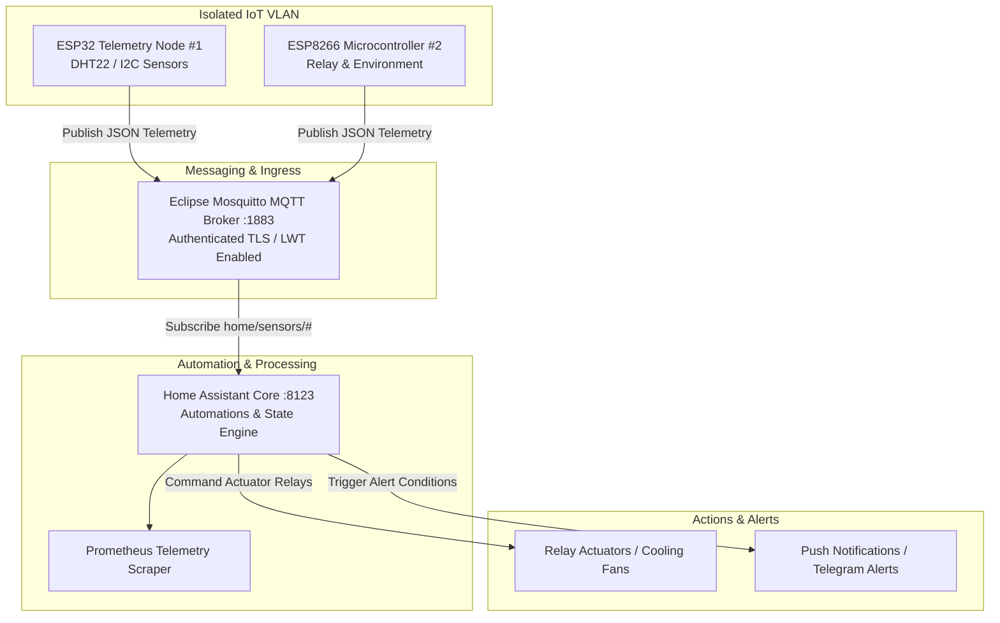

# :satellite: Edge IoT Telemetry & Automation Platform

[](https://platformio.org)
[](https://espressif.com)
[](https://mosquitto.org)
[](https://www.home-assistant.io)

An end-to-end edge Internet-of-Things (IoT) platform connecting physical microcontrollers (ESP32/ESP8266) to private cloud telemetry engines over an isolated IoT VLAN. Features C++ firmware with Last Will & Testament (LWT) disconnect monitoring, authenticated MQTT pub/sub data streams, and automated Home Assistant threshold triggers.

---

## :triangular_ruler: Edge IoT Architecture



---

## :gear: MQTT Topic Taxonomy

| Topic Pattern | Direction | Payload Example | Description |
| :--- | :--- | :--- | :--- |
| `home/sensors/+/telemetry` | Publish | `{"temperature": 24.5, "humidity": 55.2, "rssi": -62}` | Periodic sensor telemetry payload |
| `home/sensors/+/status` | LWT / State | `"online"` / `"offline"` | Last Will & Testament connectivity state |
| `home/actuators/cooling/relay1` | Subscribe | `"ON"` / `"OFF"` | Actuator switch control state |

---

## :rocket: Deployment & Provisioning

### 1. Boot Local Services
```bash
git clone https://github.com/Aryan-136/iot-automation-platform.git
cd iot-automation-platform

docker compose up -d
```

### 2. Flashing ESP32 Firmware
```bash
cd firmware/esp32_telemetry
# Compile and flash via PlatformIO
pio run --target upload
```

---

## :file_folder: Repository Layout
```text
.
├── config/
│   ├── homeassistant/
│   │   └── automations.yaml      # Automated threshold triggers & alerts
│   └── mosquitto/
│       └── mosquitto.conf        # Hardened MQTT broker configuration
├── firmware/
│   └── esp32_telemetry/
│       └── src/
│           └── main.cpp          # Production C++ firmware with JSON serialization
├── docker-compose.yml            # Mosquitto & Home Assistant orchestration
└── README.md                     # Architectural documentation & topic taxonomy
```